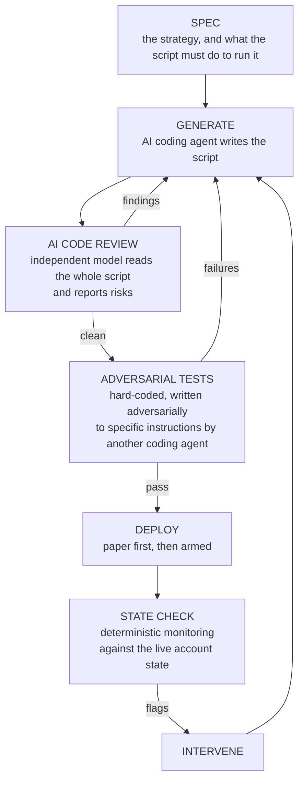

# Agentic DevOps and Observability

This repo contains DevOps and observability code samples for algorithmic trading
scripts generated with AI: independent AI code review, adversarial testing, and
deterministic anomaly monitoring of the live scripts.

They are selected samples and assets extracted from a larger proprietary
codebase to demonstrate the approach.

The code and approach were used to reach a finalist position in a quantitative
trading hackathon when tested against a live trading simulation and hundreds of
competitors.

## Repo contents

| Folder | File | What it does |
|---|---|---|
| **`code-review/`** | `ai_code_review.py` | sends an execution script to an independent model and returns a prioritised risk review of the whole file, weighted toward the bug class that fast code generation produces |
| **`state-checks/`** | `account_state_check.py` | deterministic checks against the live account: orphaned positions, unconfirmed fills, wrong direction, position stacking, leverage overshoot. Reports, never trades |
| **`execution/`** | `mt5_execute_finals.py` | the live executor. Momentum-gated entry, stacks to target leverage, locks when the projected competition score clears the target rank, hard floor, forced flatten before the cutoff |
| | `EXAMPLE_OUTPUTS.md` | real captured output from all three |

The research that decided what to trade is in the separate
[game-theoretic quant strategies](https://github.com/Z37K/game-theoretic-quant-strategies)
repo. Earlier iterations of the executor and the test suite are not published.

## Context

A two-week live algorithmic trading competition on simulated capital, real
market quotes and a realistic execution model.

- **Platform:** MetaTrader 5, driven from Python. No REST API, so the script
  attaches to a running terminal
- **Execution:** depth, partial fills, slippage and market impact all modelled
- **Format:** daily rounds, each scored on equity at a fixed cutoff
- **Elimination:** forced liquidation at 30% margin level ends the run outright
- **Constraint:** one order clamps at 100 lots, below the target position size,
  so any position has to be built by stacking orders

I entered at the second week, skipping the testing and strategising phase. That
meant developing strategies and operating them in the market at the same time,
so the ability to test, deploy and trade in quick succession was the whole game.

## Approach

AI code generation allows algorithmic trading scripts to be built rapidly, as new
strategies are committed and need to be implemented in minutes or hours. It also
makes a predictable set of mistakes: orders assumed filled, partial fills treated
as complete, positions left open when a step fails, logic reused from another
script without adapting it. In a live trading script those cause actual losses.

In this repo we've extracted three sample gates that catch them. Two before the
code runs, one while it is running:

| | Description |
|---|---|
| **AI code review** | an independent model reads the whole script and reports risks |
| **Adversarial tests** | hard-coded tests written adversarially to specific instructions by another coding agent |
| **State check** | deterministic monitoring against the live account state |

This is an approach to DevOps and observability for AI-driven development, where
requirements are fast moving and volatile. This means testing and observability
have to be equally dynamic and fast moving.



---

# Worked example: a live trading competition

## 1. Example of generated code

All generated code in this example is for algorithmic trading, meaning it has to
place the correct orders, at the correct volume, at the correct time.

The intended strategy determines the exact structure of the code. For example:
enter BTC when 12-hour momentum clears a threshold, build to 8x leverage, exit
when the projected competition score clears top 25, stop out at a floor, and be
flat before the round's cutoff.

An AI coding agent turns that spec into a Python script against the broker's API.
`execution/mt5_execute_finals.py` is the result:

```
load_board()        load the field snapshot, for percentile ranks
wait_for_signal()   poll until 12h momentum clears the threshold
stack_to_target()   build toward 8x across repeated orders, one caps at 100 lots
manage()            track equity and Sharpe, recompute the projected score, watch the clock
flatten()           close the whole position on lock, stop, or cutoff
```

These scripts all execute real orders.

### An example error

`flatten()` has to close the position before the cutoff, or the account is scored
while still holding risk.

In a real example, the agent's initial script attempted to send a single order
and assumed the platform would process it in full, without consideration for
size. That is fine on an API where a close completes in one call. Here the broker
can fill part of an order and still return success, so the script believed it was
flat while a position was still open.

The corrected version:

```python
def flatten(symbol, reason):
    """Close the WHOLE position, retrying in <=100-lot chunks until truly flat (partial-fill safe).
    THE FIX vs last time: the old version fired ONE IOC order and returned -> a partial fill orphaned lots."""
```

It checks the real position after every order and keeps going until it is gone,
instead of trusting the response.

The tools below catch errors like these before they reach production, and catch
runtime anomalies for active scripts.

## 2. AI Code review

`code-review/ai_code_review.py` sends a script to an independent model and asks
for a prioritised risk review.

The review runs to a fixed brief: named failure modes, ranked by risk, each with
a location and a one-line fix, and an instruction to say when something is fine
rather than invent problems. It defaults to NVIDIA
Llama-3.3-Nemotron-Super-49B.

On the executor, its top two findings were:

```
1. Orders sent but fill never confirmed (assumed successful)
   In stack_to_target, after send_add the code does not verify the fill actually
   occurred; a failed/partial fill can lead to over-leveraging or wrong sizing.

2. Position left open during flatten (partial fills)
   If the position can't be fully closed within the 180s timeout, flatten exits
   without ensuring it is closed, residual lots could survive HARD_EXIT.
```

Unconfirmed fills and an incomplete flatten, found from the code alone.

## 3. Deterministic state checks

`state-checks/account_state_check.py` is the observability layer over the live
run. It compares the real account against what the strategy expects:

| Check | Severity |
|---|---|
| should be flat but positions are open | CRITICAL |
| orders sent with no confirmed fill | CRITICAL |
| position direction opposite to intended | CRITICAL |
| leverage above the hard limit | CRITICAL |
| position on an unintended symbol | WARN |
| more positions than expected, on a netting account | WARN |
| leverage overshooting target by more than 25% | WARN |

It reports and never trades. Run directly, it demos the checks against a seeded
state, no broker needed.

## 4. The executor

`execution/mt5_execute_finals.py` is the script those gates protect.

- **Entry** is gated on a 12-hour momentum threshold, never a held view.
- **Sizing** stacks toward 8x across repeated orders, since one order clamps at
  100 lots. Each pass re-reads live volume and adds only the gap, so a partial
  fill cannot compound into an overshoot.
- **The lock** computes a projected competition score from return rank,
  estimated Sharpe rank and locked drawdown rank, and exits the moment that
  projection clears the target rank. It accounts for the Sharpe drop that going
  flat itself causes, and only locks if the score still clears after it.
- **The floor** is a stop set far inside the forced-liquidation line, so a bad
  outcome is a survivable loss rather than elimination.
- **The cutoff** forces a flatten before the score is snapshotted.

## On the code

`ai_code_review.py` calls NVIDIA's hosted NIM endpoint, so no local GPU is
needed. Without an API key it prints setup steps rather than fabricating a
review.

The executor needs MetaTrader 5 and a running terminal, so it will not run
as-is. It defaults to paper mode and places nothing until armed.
`account_state_check.py` runs standalone.

Competitor names are replaced with identifiers in any referenced data.
